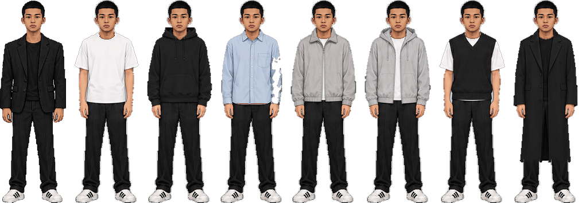
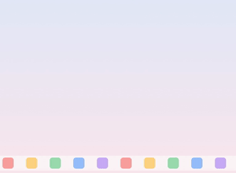
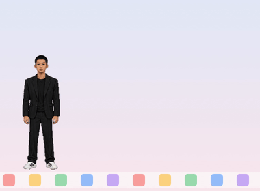
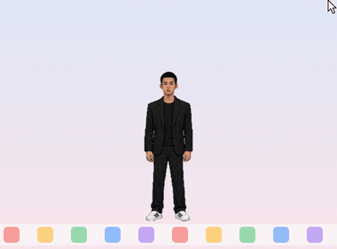
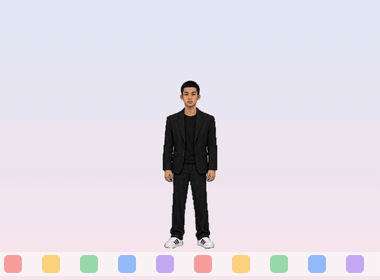
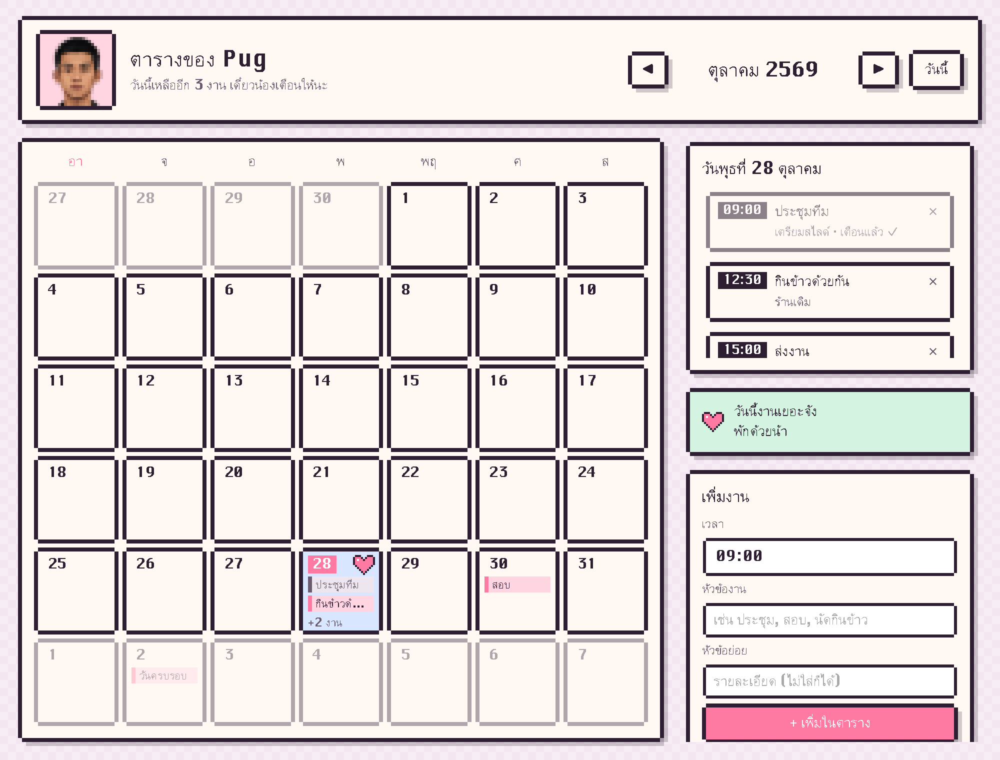
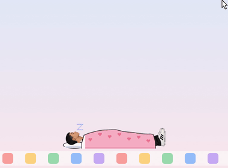

<div align="center">


# Pug

**เพื่อนตัวเล็กที่เดินเล่นอยู่บนจอ Mac ของเธอ**

จิ้มได้ ยกได้ เขย่าได้ เปลี่ยนชุดได้ เตือนนัดให้ได้ และจะบอกฝันดีก่อนนอนทุกคืน



[](https://github.com/Pug-03/Desktop-Pet-Pug/raw/main/Pug.zip)


</div>

---

## 💌 ติดตั้ง (สำหรับแฟน)

1. กดปุ่ม **ดาวน์โหลด** สีชมพูข้างบน จะได้ไฟล์ `Pug.zip` อยู่ในโฟลเดอร์ Downloads
2. ดับเบิลคลิก `Pug.zip` จะได้แอป **Pug**
3. ลาก **Pug** ไปวางในโฟลเดอร์ **Applications**
4. ดับเบิลคลิกเปิด **Pug** ครั้งแรก Mac จะเตือนว่าไม่รู้จักผู้พัฒนา (เพราะเป็นแอปที่ทำเองให้เธอ ไม่ได้ขายใน App Store) ให้ทำตามนี้ครั้งเดียว
   - กด **Done**
   - เปิด **System Settings → Privacy & Security** เลื่อนลงล่างสุด เจอบรรทัด *"Pug" was blocked…* กด **Open Anyway**
   - ใส่รหัสเครื่อง แล้วกด **Open**
5. เสร็จแล้ว! Pug จะตกลงมาจากข้างบนจอแล้วโบกมือทักทาย 👋
   ตั้งแต่นี้เปิดเครื่องเมื่อไหร่ก็จะมาเองทุกครั้ง

> ถ้าหาตัวไม่เจอ ดูที่แถบเมนูด้านบนขวาของจอ จะมีหน้าเล็กๆ ของ Pug กดแล้วเลือก **เรียกมาหา**

---

## 🎮 เล่นยังไง

<table>
<tr>
<td align="center" width="50%"><br><b>เปิดแอป</b><br>ตกลงมาจากฟ้า แล้วโบกมือทักทาย</td>
<td align="center" width="50%"><br><b>ปล่อยไว้เฉยๆ</b><br>ยืน กะพริบตา แล้วค่อยๆ เดินเล่นไปมา</td>
</tr>
<tr>
<td align="center"><br><b>คลิก 1 ที</b><br>จั๊กจี้ หัวเราะคิกคัก · คลิกรัวๆ = มึนหัว</td>
<td align="center"><br><b>กดค้างแล้วลาก</b><br>ถูกยกขึ้น ตัวแกว่งตามเมาส์ · ปล่อยแล้วตกลงพื้น</td>
</tr>
<tr>
<td align="center"><br><b>เขย่าแรงๆ</b><br>ตกใจ เหงื่อตก ลงพื้นแล้วมึน</td>
<td align="center"><br><b>ไม่มีใครเล่นด้วย 3 นาที</b><br>หาว บอกฝันดี คิดถึง แล้วนอนห่มผ้า</td>
</tr>
</table>

| ทำอะไร | เกิดอะไรขึ้น |
|---|---|
| คลิก 1 ที | จั๊กจี้ หัวเราะ มีหัวใจลอย |
| คลิกรัวๆ 6 ที | มึนหัว ตาก้นหอย ดาววนรอบหัว |
| กดค้าง / ลาก | ถูกยกขึ้น ห้อยแกว่งตามเมาส์ |
| ยกสูงแล้วปล่อย | ตกลงพื้น ตัวยุบแล้วเด้ง |
| ลากแล้วเหวี่ยง | ลอยไปชนขอบจอแล้วเด้งกลับ |
| คลิกตอนหลับ | ตื่นงัวเงีย |

นานๆ ที (20–40 นาที) จะพูดอะไรน่ารักๆ ขึ้นมาเอง

ถ้า Dock แสดงอยู่ จะยืนบน Dock · ถ้า Dock ซ่อน (ซ่อนอัตโนมัติ หรือเปิดแอปเต็มจอ) จะยืนบนขอบล่างสุดของจอ

### สีหน้า


---

## 👕 เปลี่ยนชุด



คลิกขวาที่ตัว หรือคลิกหน้า Pug บนแถบเมนู → **เปลี่ยนชุด**

มี 17 แบบ เปลี่ยนแค่เสื้อ กางเกงกับรองเท้าเหมือนเดิม

สูทดำ (ชุดเดิม) · เสื้อยืดดำ · เสื้อยืดขาว · เสื้อโปโล · เสื้อลายขวาง · ฮู้ด · สเวตเตอร์ · เชิ้ตแขนสั้น · เชิ้ตแขนยาว · แจ็กเก็ตสีอ่อน · แจ็กเก็ตสีเข้ม · คาร์ดิแกน · ฮู้ดซิป · สเวตเชิ้ต · เสื้อกั๊ก · โอเวอร์เชิ้ต · โค้ทยาว

หรือกด **สุ่มชุด** ให้เลือกให้เลย

<br clear="right">

---

## 📅 ตาราง & แจ้งเตือน

คลิกขวาที่ตัว → **ตาราง / แจ้งเตือน…** จะเปิดปฏิทินรายเดือน (สไตล์ pixel เหมือนตัวน้อง)



1. กดวันที่ในปฏิทิน
2. ใส่ **เวลา**, **หัวข้องาน** และ **หัวข้อย่อย** (ไม่ใส่ก็ได้) แล้วกด **+ เพิ่มในตาราง**
3. ถึงเวลาเมื่อไหร่ น้องจะเด้งขึ้นมา (ถ้าหลับอยู่ก็ตื่น) มีเสียงเตือนเบาๆ แล้วโบกมือบอกงานนั้น จิ้มที่ตัวเพื่อรับทราบ



- งานที่เตือนแล้วจะขึ้น **เตือนแล้ว ✓** ลบงานได้ด้วยปุ่ม ✕
- วันไหนมีงานตั้งแต่ 4 อย่างขึ้นไป จะมีหัวใจที่วันนั้น และน้องจะบอกว่า **"งานเยอะจัง พักด้วยน้า"**
- ถ้าปิดเครื่องไว้ตอนถึงเวลา เปิดเครื่องภายใน 1 ชั่วโมงก็ยังเตือนให้

---

## ⚙️ เมนู

คลิกขวาที่ตัว หรือคลิกหน้า Pug บนแถบเมนูด้านบนจอ

| เมนู | ทำอะไร |
|---|---|
| ซ่อนตัว / แสดงตัว | ซ่อนชั่วคราว |
| เรียกมาหา | ให้ตกลงมาตรงเมาส์ |
| พูดอะไรหน่อย | สุ่มพูด 1 ประโยค |
| ตาราง / แจ้งเตือน… | เปิดปฏิทินใส่งาน ถึงเวลาน้องเตือน |
| ให้นอนเลย / ปลุก | สั่งนอนหรือปลุก |
| เปลี่ยนชุด | 17 ชุด + สุ่มชุด |
| ขนาด | เล็ก · กลาง · ใหญ่ |
| ง่วงนอนเมื่อไม่มีใครเล่นด้วย | 1 · 3 · 5 · 10 · 30 นาที |
| เดินเล่นไปมา | เปิด/ปิดการเดิน |
| แก้ไขข้อความ… | แก้คำพูดเองได้ |
| เปิดเองตอนเปิดเครื่อง | เปิด/ปิด |

### ✏️ แก้คำพูด

เมนู → **แก้ไขข้อความ…** จะเปิดไฟล์ใน TextEdit แก้ข้อความในวงเล็บ `[ ]` ได้เลย บันทึกแล้วมีผลทันที

```json
"goodnight": ["ฝันดีน้าา", "คิดถึงนะ", "โทรมาหาได้น้าา"],
```

ถ้าแก้แล้วไฟล์พัง ไม่เป็นไร Pug จะใช้ข้อความเดิมแทน

---

## 🗑️ ถอนการติดตั้ง

1. เมนู → ปิด **เปิดเองตอนเปิดเครื่อง** แล้วกด **ออก**
2. ลบ **Pug** ออกจากโฟลเดอร์ Applications

---

<details>
<summary><b>🛠️ สำหรับคนทำ</b></summary>

<br>

```bash
./build.sh                                            # สร้าง sprite ทั้งหมด + build/Pug.app (universal)
build/Pug.app/Contents/MacOS/Pug --record demo        # อัดคลิปตัวอย่างลง demo/ (ต้องมี ffmpeg)
ditto -c -k --keepParent build/Pug.app Pug.zip        # ทำไฟล์สำหรับแจก
```

| ส่วน | ไฟล์ |
|---|---|
| รูปต้นฉบับ | `reference/sheet3.png` (ตัว ท่าเดิน มุมข้าง) · `expressions.png` (สีหน้า 11 แบบ) · `yawn.jpg` · `outfits.png` (16 ชุด) |
| ตัดภาพ + แปะสีหน้า | `tools/extract.py` → `art/parts/` |
| ใส่ชุด | `tools/outfits.py` (เปลี่ยนเฉพาะเสื้อ) |
| ประกอบท่า | `tools/poses.py` (ยืน เดิน หัวเราะ ถูกยก ตก มึน นอนห่มผ้า) |
| เอฟเฟกต์ pixel | `tools/effects.py` |
| รวม atlas / ไอคอน | `tools/build_sprites.py` · `tools/make_icon.py` |
| แอป (Swift) | `App/Sources/` — `Engine` พฤติกรรม/ฟิสิกส์ · `Renderer` วาด · `App` หน้าต่าง/เมนู/แจ้งเตือน · `Schedule` ตาราง · `Messages` คำพูด · `Recorder` อัดคลิป |
| หน้าตาราง | `App/Resources/schedule.html` (ข้อมูลเก็บที่ `~/Library/Application Support/Pug/schedule.json`) · `Pug --schedule-preview out.png` ถ่ายภาพหน้าตารางตัวอย่าง |

</details>

<div align="center">
<sub>ทำด้วยความคิดถึง 💗</sub>
</div>
