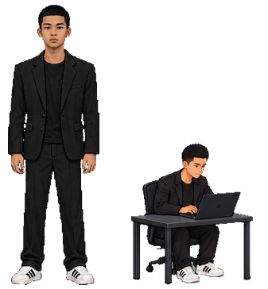
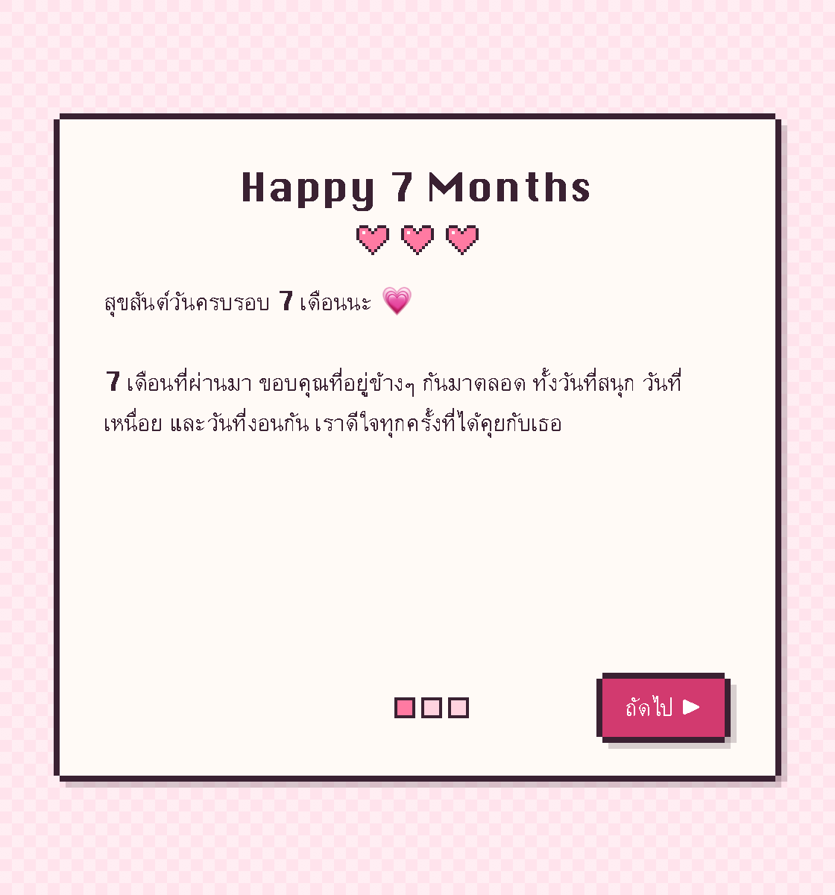
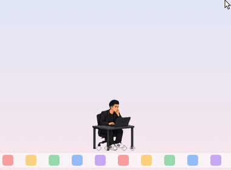

<div align="center">


# Pug

**A tiny buddy who lives at the bottom of your Mac screen**

Poke him, pick him up, shake him, keep him company while he codes, let him remind you of your plans, and he'll say good night every night.



[](https://github.com/Pug-03/Desktop-Pet-Pug/raw/main/Pug.zip)


</div>

---

## Install

1. Click the pink **Download** button above. You'll get `Pug.zip` in your Downloads folder.
2. Double-click `Pug.zip` to get the **Pug** app.
3. Drag **Pug** into your **Applications** folder.
4. Double-click **Pug** to open it. The first time, your Mac will say it doesn't recognise the developer (it's an app made just for you, not one from the App Store). Do this once:
   - Click **Done**
   - Open **System Settings → Privacy & Security**, scroll to the bottom, find *"Pug" was blocked…* and click **Open Anyway**
   - Enter your Mac password, then click **Open**
5. The first time it opens there's a **letter for our 7-month anniversary**. Read it, then click **Open your gift** and Pug drops in from the top of the screen.
   From now on he comes by himself every time you turn on your Mac.

 

> Once he has said hello, the **How to play** page opens by itself: 8 short lessons with clips showing what you can do. Click **Next** to go through them.
> To read the letter or the lessons again, right-click him → **Anniversary letter…** or **How to play…**

> Can't find him? Look at the top right of the menu bar for Pug's little black-and-white face, click it and choose **Call him**.

---

## How to play

<table>
<tr>
<td align="center" width="50%"><br><b>Open the app</b><br>He drops in from the sky and waves hello</td>
<td align="center" width="50%"><br><b>Leave him be</b><br>He breathes, blinks and strolls around</td>
</tr>
<tr>
<td align="center"><br><b>Click once</b><br>It tickles and he giggles · click fast and he gets dizzy</td>
<td align="center"><br><b>Hold and drag</b><br>He's picked up and swings with the mouse · let go and he drops</td>
</tr>
<tr>
<td align="center"><br><b>Shake him hard</b><br>He panics, sweats, and lands dizzy</td>
<td align="center"><br><b>After 10 pm, left alone for 3 minutes</b><br>He yawns, says good night and sleeps under a blanket</td>
</tr>
</table>

| Do this | What happens |
|---|---|
| Click once | It tickles; he giggles and hearts float up |
| Click 6 times fast | Dizzy: swirly eyes, stars round his head |
| Hold / drag | He's picked up and dangles along with the mouse |
| Lift him high and let go | He lands, squashes and bounces |
| Drag and flick | He flies into the edge of the screen and bounces back |
| Click while he sleeps | He wakes up groggy |
| Click while he works | He turns to look at you and says something |

Every so often (20–40 minutes) he says something sweet by himself.

When he's above the Dock he stands on it; past either end of the Dock he hops down to the bottom edge of the screen. When the Dock is hidden (auto-hide, or a full-screen app) he always stands on the screen edge. After you swipe to another screen he's already standing on its floor.

### Coding at his desk

<table>
<tr>
<td align="center" width="50%"><br><b>Daytime, left alone for 3 minutes</b><br>He pulls up a desk and MacBook, thinks first, then codes for a long stretch with web and AI code floating up · now and then he turns round to cheer you on</td>
<td align="center" width="50%"><br><b>Working after 10 pm</b><br>He nods off at the desk · click him and he carries on</td>
</tr>
</table>


- He starts by thinking with his chin in his hand, then types for 1–2 minutes at a time, with short random breaks: thinking · looking up · smiling when the code works · frowning at a bug · a drink · a stretch
- Click him while he works and he turns to look, or jumps a little
- Every 5–10 minutes he turns round to cheer you on, for example "You've got this!", with hearts
- After about an hour of work he gets up for a 2–5 minute walk, then sits back down
- He only goes to bed after 10 pm (until 6 am); before that he works instead. If he is still asleep when 6 am comes, he gets up by himself

### Faces


---

## Schedule & reminders

Right-click him → **Schedule / reminders…** to open a monthly calendar (light blue pixel style).


1. Click a day on the calendar. For a plan over several days (for example Oct 30 – Nov 2), hold the mouse on the first day for a moment and then drag across the days, hold Shift and click the last day, or pick **From** / **To** (it works across months). Scroll over the calendar to change month. The 1st of each month shows the month's name, like "Nov 1".
2. Fill in **Time**, **Title** and **Details** (optional). Under **Remind me**, pick on time, 15 minutes, 1 hour or 1 day before. Under **Repeat**, pick every week, month or year for things like a class, a monthly anniversary or a birthday (a repeating plan is one day long). Then click **+ Add to schedule**.
3. When it's time (a plan over several days reminds you on its first day) he jumps up (waking if he's asleep), a soft chime plays, and he waves the plan at you. Click him to say OK.


- Plans he has reminded you of show **Reminded ✓**. Delete a plan with the ✕ button.
- A day with 4 or more plans gets a heart, and he tells you to take a break.
- If your Mac was off when a plan was due, he still reminds you if you turn it on within an hour.

---

## Menu

Right-click him, or click Pug's face in the menu bar at the top of the screen.

| Menu | What it does |
|---|---|
| Hide / Show | Hide him for a while |
| Call him | He drops in where the mouse is |
| Say something | He says one random line |
| Schedule / reminders… | The calendar for your plans; he reminds you on time |
| Anniversary letter… | Read the letter again (open the gift and he says its closing lines) |
| How to play… | Short lessons on what you can do, with clips |
| Sleep now / Wake up | Send him to bed, or wake him |
| Size | Small · Medium · Large |
| Work or sleep when left alone | After 1 · 3 · 5 · 10 · 30 min |
| Walk around | Turn his walking on or off |
| Language (ภาษา) | English or Thai: the menu, his lines, the letter, the calendar and the lessons |
| Edit lines… | Change the things he says |
| Open at login | On / off |
| Check for updates… | Looks for a new Pug and installs it (shows **Update Pug to …** when one is ready) |

### Change what he says

Menu → **Edit lines…** opens a file in TextEdit (in Thai, the Thai lines have their own file). Change the lines inside the `[ ]` brackets; saved changes apply right away.

```json
"goodnight": ["Good night~", "Miss you already", "Call me if you can't sleep"],
```

If the file gets broken, don't worry: Pug goes back to his usual lines.

---

## Updating

When there's a new version, he tells you himself. Then:

1. Right-click him (or click Pug's face in the menu bar) and choose **Update Pug to …** (or **Check for updates…** to look yourself).
2. Click **Update**. He disappears for a moment and comes right back as the new version.

Your plans, settings and edited lines stay as they are, and the letter doesn't pop up again.

> Coming from version 1.0, which has no update button: quit Pug from the menu, download `Pug.zip` again, drag the new **Pug** into Applications and click **Replace**. After that, updates are one click.

---

## Uninstall

1. Menu → turn off **Open at login**, then click **Quit**
2. Delete **Pug** from your Applications folder

---

<details>
<summary><b>For the maker</b></summary>

<br>

```bash
./build.sh                                            # all sprites + build/Pug.app (universal)
build/Pug.app/Contents/MacOS/Pug --record demo        # record the demo clips into demo/ (needs ffmpeg)
build/Pug.app/Contents/MacOS/Pug --update-now        # install the newest build from GitHub (tests the updater)
```

`./build.sh` also writes `Pug.zip` and `latest.json`. To release: raise `CFBundleVersion` (and `CFBundleShortVersionString`) in `App/Info.plist`, run `./build.sh`, then commit and push. The app reads `latest.json` from GitHub; any build number higher than its own counts as an update.

| Part | Files |
|---|---|
| Source art | `reference/sheet3.png` (body, walk, side view) · `expressions.png` (11 faces) · `yawn.jpg` · `desk.png` (11 desk poses used) |
| Cut-out + faces | `tools/extract.py` → `art/parts/` (also clears the sheet's white outline, including narrow gaps between arm and body, inside fists and between the legs, so nothing light shows on a dark desktop) |
| Desk | `tools/desk.py` (cuts 11 desk poses from `desk.png`, scales them and lines the desk up across poses) |
| Poses | `tools/poses.py` (stand, walk, laugh, held, fall, dizzy, asleep under a blanket) |
| Pixel effects | `tools/effects.py` |
| Atlas / icon | `tools/build_sprites.py` · `tools/make_icon.py` |
| App (Swift) | `App/Sources/` — `Engine` behaviour/physics · `Renderer` drawing · `App` window/menu/reminders · `Schedule` calendar · `Messages` lines · `Letter` letter and guide · `Recorder` demo clips |
| How to play | `App/Resources/guide.html` + mp4 clips in `App/Resources/guide/` · `Pug --guide-preview out.png [lesson]` |
| Letter | `App/Resources/letter.json` (the letter and his lines after the gift) · `letter.html` · `Pug --letter-preview out.png [page]` · to see the first-launch letter again: `defaults delete com.pug.desktoppet letterShown` |
| Schedule | `App/Resources/schedule.html` (data in `~/Library/Application Support/Pug/schedule.json`) · `Pug --schedule-preview out.png` |
| Demo clips | `demo/` (one per behaviour, `00_all.mp4` has them all) |

</details>

<div align="center">
<sub>Made with love</sub>
</div>
